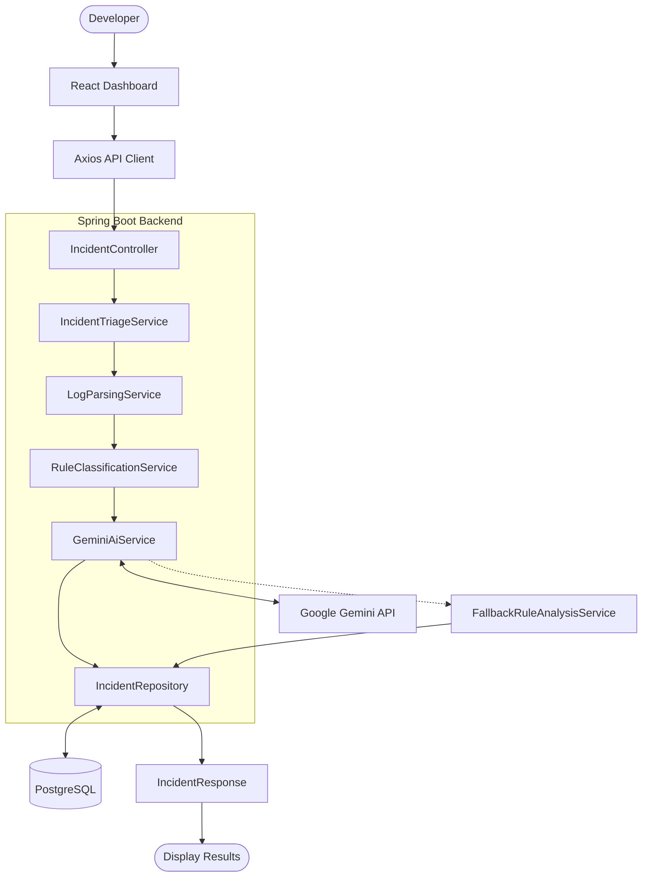
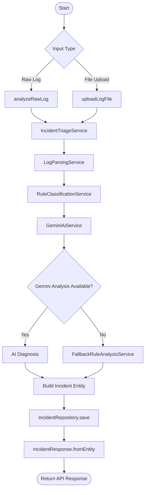

# TraceWise AI
### Intelligent Incident Diagnosis and Root-Cause Analysis Platform

TraceWise AI is a full-stack application designed to help developers investigate application failures through automated log analysis and AI-assisted root-cause diagnosis.

The system accepts raw application logs or uploaded log files, extracts exception and stack-trace information, classifies incidents using a rule-based engine, and generates probable root causes and debugging recommendations using Google Gemini AI. It also provides deterministic fallback analysis, incident history, dashboard analytics, and benchmark evaluation.

---

## 1. Key Features

- **Log Analysis:** Accepts raw log text and uploaded `.log`, `.txt`, and `.json` files.
- **Stack Trace Extraction:** Identifies exception types, nested causes, application classes, methods, and line numbers.
- **Incident Classification:** Uses predefined rules to identify incident categories and severity levels.
- **AI-Based Diagnosis:** Integrates Google Gemini to generate probable root causes, supporting evidence, recommended fixes, and prevention strategies.
- **Fallback Analysis:** Uses deterministic rule-based analysis when Gemini is unavailable or an API request fails.
- **Incident Management:** Supports incident search, filtering, pagination, status updates, and deletion.
- **Dashboard Analytics:** Displays incident counts, severity distribution, workflow status, and average confidence.
- **Benchmark Evaluation:** Evaluates classification, severity prediction, root-cause keyword matching, and analysis latency using eight predefined test cases.
- **System Health:** Provides database connectivity, AI configuration, and JVM runtime information.

## 2. Technology Stack

| Layer | Technologies |
|---|---|
| Frontend | React 18, JavaScript, Vite |
| UI | Bootstrap 5, Bootstrap Icons |
| HTTP Client | Axios |
| Backend | Java 21, Spring Boot 3.3.4 |
| API | Spring Web, REST |
| AI Integration | Google Gemini API |
| Database | PostgreSQL |
| ORM | Spring Data JPA, Hibernate |
| HTTP Communication | RestTemplate |
| JSON Processing | Jackson |
| API Documentation | Swagger / OpenAPI |
| Testing | JUnit 5, Spring Boot Test, MockMvc, H2 |
| Build Tools | Maven, npm |

## 3. System Architecture

TraceWise AI follows a layered architecture that separates the frontend, API handling, business logic, AI integration, and data persistence.

The React frontend communicates with the Spring Boot backend through REST APIs. The backend processes incoming logs using dedicated parsing and classification services before requesting AI-assisted diagnosis. The resulting incident is stored in PostgreSQL and returned to the frontend.

### Architecture Diagram



### Architecture Responsibilities

| Layer | Implementation Responsibility |
|---|---|
| Presentation | Collects logs, displays analysis results, and manages incident views. |
| Controller | Exposes REST endpoints and handles incoming requests. |
| Service | Coordinates parsing, classification, diagnosis, and persistence. |
| AI Integration | Communicates with Gemini and invokes deterministic fallback analysis when required. |
| Repository | Performs database operations using Spring Data JPA. |
| Database | Stores incident information and analysis results. |

## 4. Backend Execution Flow

The primary incident analysis workflow is implemented in `IncidentTriageService`, with `analyzeAndSaveIncident(AnalyzeLogRequest request)` acting as the main processing method.

Both raw-text submission and file upload eventually call this same service method. The file-upload endpoint first reads the uploaded file and converts its contents into an `AnalyzeLogRequest`.

### Incident Analysis Flowchart



### Processing Sequence

| Step | Class / Method | Responsibility |
|---|---|---|
| 1 | `IncidentController.analyzeRawLog()` | Accepts raw log text through a JSON request. |
| 2 | `IncidentController.uploadLogFile()` | Reads uploaded file contents and creates an analysis request. |
| 3 | `IncidentTriageService.analyzeAndSaveIncident()` | Coordinates the complete incident analysis workflow. |
| 4 | `LogParsingService.parse()` | Extracts structured exception and stack-trace information. |
| 5 | `RuleClassificationService.classify()` | Determines incident category, severity, and rule confidence. |
| 6 | `GeminiAiService.analyze()` | Selects Gemini analysis or deterministic fallback. |
| 7 | `IncidentRepository.save()` | Persists the completed incident. |
| 8 | `IncidentResponse.fromEntity()` | Converts the saved entity into the API response. |

## 5. Core Backend Implementation

### 5.1 Log Parsing — `LogParsingService`

**Entry method:** `parse(String rawLog)`

This service converts unstructured application logs into structured information using Java regular expressions.

The parser examines the log line by line and extracts:

| Information | Pattern Used |
|---|---|
| Timestamp | `TIMESTAMP_PATTERN` |
| Log level | `LOG_LEVEL_PATTERN` |
| Thread name | `THREAD_PATTERN` |
| Exception declaration | `EXCEPTION_HEADER_PATTERN` |
| Nested exception | `CAUSED_BY_PATTERN` |
| Stack-trace location | `STACK_FRAME_PATTERN` |

**Important methods**

- `parse()` – Processes log lines and constructs `ParsedLogInfo`.
- `isApplicationClass()` – Filters common JVM, framework, and database-driver packages to identify application-level stack frames.
- `extractHeuristicError()` – Identifies common errors when a standard Java exception declaration is unavailable.

The parser identifies the primary exception, deepest detected nested cause, main error message, stack-trace lines, application class, method, line number, and surrounding context.

**Output:** `ParsedLogInfo`

### 5.2 Rule-Based Classification — `RuleClassificationService`

**Entry method:** `classify(String rawLog, ParsedLogInfo parsedLog)`

The classification service combines the original log with extracted exception information and evaluates predefined patterns.

**Implemented incident categories**

| Category | Example Error Patterns |
|---|---|
| `MEMORY_RESOURCE` | OutOfMemoryError, heap space, Metaspace |
| `DATABASE` | SQLException, PostgreSQL, HikariCP, deadlock |
| `AUTHENTICATION` | JWT errors, unauthorized access, invalid credentials |
| `CONCURRENCY` | ConcurrentModificationException, optimistic locking |
| `NETWORK` | SocketTimeoutException, connection refused |
| `THIRD_PARTY` | FeignException, upstream API failures, gateway errors |
| `APPLICATION_LOGIC` | NullPointerException, IllegalArgumentException, ClassCastException |
| `UNKNOWN` | No matching classification rule |

**Important methods**

- `determineCategory()` – Checks predefined error patterns and identifies the incident category.
- `determineSeverity()` – Assigns severity based on category and error indicators.
- `calculateConfidence()` – Calculates rule confidence based on the number of matched rules.

**Severity levels:** `CRITICAL`, `HIGH`, `MEDIUM`, `LOW`.

The service returns a `RuleClassificationResult` containing the category, severity, matched rules, confidence, and classification rationale.

### 5.3 Gemini AI Integration — `GeminiAiService`

**Entry method:** `analyze(String rawLog, ParsedLogInfo parsedLog, RuleClassificationResult ruleResult)`

This service integrates Google Gemini into the incident diagnosis process using Spring's `RestTemplate`.

**Implementation**

1. Checks API-key availability using `GeminiConfig.hasApiKey()`.
2. Creates a diagnostic prompt using the raw log, parsed exception details, and classification result.
3. Limits the raw log included in the prompt to 6,000 characters.
4. Sends a POST request to Gemini's `generateContent` endpoint.
5. Requests structured JSON output using `responseMimeType: application/json` and temperature `0.2`.
6. Processes the response using Jackson's `ObjectMapper`.
7. Converts the generated response into an `AiAnalysisResult`.

**Important methods**

| Method | Responsibility |
|---|---|
| `analyze()` | Controls AI analysis and fallback selection. |
| `callGeminiApi()` | Builds and sends the HTTP request to Gemini. |
| `buildPrompt()` | Constructs the incident diagnosis prompt. |
| `parseGeminiResponse()` | Extracts and maps the generated JSON response. |

**Generated analysis contains**

- Probable root cause
- Supporting evidence
- Recommended fixes
- Prevention strategies
- Confidence score
- Analysis provider

### 5.4 Deterministic Fallback — `FallbackRuleAnalysisService`

**Entry method:** `analyze(String rawLog, ParsedLogInfo parsedLog, RuleClassificationResult ruleResult)`

This service provides diagnostic recommendations without relying on an external AI response.

It uses the detected incident category and parsed exception information to generate predefined explanations and recommendations for database, memory, network, authentication, concurrency, third-party, and application runtime failures.

The output follows the same `AiAnalysisResult` structure used by the Gemini integration. The provider is identified as `DETERMINISTIC_FALLBACK`.

This allows the application to continue generating incident reports when the Gemini API key is missing or an API request fails and fallback is enabled.

## 6. Database and Persistence

TraceWise AI uses PostgreSQL for storing incident records. Spring Data JPA and Hibernate handle object-relational mapping between Java entities and database tables.

**Main entity:** `Incident`

**Database table:** `incidents`

The entity stores:

| Field | Description |
|---|---|
| `id` | Unique incident identifier |
| `title` | Incident title |
| `serviceName` | Affected service |
| `environment` | Application environment |
| `category` | Classified incident category |
| `severity` | Assigned severity |
| `status` | Incident workflow status |
| `rawLog` | Original submitted log |
| `stackTrace` | Extracted stack trace |
| `exceptionType` | Primary exception |
| `rootCauseException` | Detected nested/root-cause exception |
| `culpritClass` | Identified application class |
| `culpritMethod` | Identified method |
| `culpritLineNumber` | Source line number |
| `probableRootCause` | Generated diagnosis |
| `evidence` | Supporting evidence |
| `recommendedFixes` | Corrective recommendations |
| `preventionStrategies` | Preventive recommendations |
| `confidenceScore` | Analysis confidence |
| `analysisProvider` | Gemini or deterministic fallback |
| `resolutionNotes` | Incident investigation notes |
| `createdAt`, `updatedAt` | Record timestamps |

**Repository:** `IncidentRepository`

The repository extends `JpaRepository<Incident, Long>` and `JpaSpecificationExecutor<Incident>`.

It supports:

- Saving and retrieving incidents.
- Filtering incidents by category, severity, and status.
- Searching incident titles, service names, exception types, and probable root causes.
- Pagination and sorting.
- Dashboard statistics and aggregate queries.

The entity also uses lifecycle callbacks to maintain creation and update timestamps.

## 7. Frontend Implementation

The frontend is developed using React and communicates with the backend through Axios.

### Main React Components

| Component | Implementation |
|---|---|
| `App.jsx` | Main dashboard, application state, data loading, and navigation. |
| `LogTriageForm.jsx` | Raw log submission, file upload, and benchmark sample selection. |
| `IncidentTable.jsx` | Displays incident records with filtering, pagination, and actions. |
| `IncidentDetailModal.jsx` | Displays detailed incident information and status updates. |
| `StatsCards.jsx` | Displays incident statistics. |
| `EvaluationView.jsx` | Displays benchmark evaluation results. |
| `SystemHealthModal.jsx` | Displays backend, database, AI configuration, and JVM health. |
| `Navbar.jsx` | Navigation and service status indicators. |

### Frontend-to-Backend Communication

The API client is implemented in `frontend/src/api/client.js`.

The `LogTriageForm` component uses `handleSubmit()` to handle the two input methods:

- **Raw text:** Creates a JSON request and calls `incidentApi.analyzeLog(payload)`.
- **File upload:** Creates a `FormData` request and calls `incidentApi.uploadLogFile(formData)`.

After receiving the response, the frontend invokes `onIncidentAnalyzed()` to update the application view.

The Axios client also provides methods for retrieving incident history, incident details, statistics, updating status, deleting incidents, running evaluations, and checking system health.

## 8. REST API Endpoints

**Base URL:** `http://localhost:8080`

### Incident APIs

| Method | Endpoint | Purpose |
|---|---|---|
| POST | `/api/v1/incidents/analyze` | Analyze pasted log text. |
| POST | `/api/v1/incidents/analyze/upload` | Upload and analyze a log file. |
| GET | `/api/v1/incidents` | Retrieve incidents with filters and pagination. |
| GET | `/api/v1/incidents/{id}` | Retrieve incident details. |
| PATCH | `/api/v1/incidents/{id}/status` | Update incident status and resolution notes. |
| DELETE | `/api/v1/incidents/{id}` | Delete an incident. |
| GET | `/api/v1/incidents/stats` | Retrieve dashboard statistics. |

### Evaluation APIs

| Method | Endpoint | Purpose |
|---|---|---|
| POST | `/api/v1/evaluation/run` | Execute benchmark evaluation. |
| GET | `/api/v1/evaluation/samples` | Retrieve predefined benchmark samples. |

### Health API

| Method | Endpoint | Purpose |
|---|---|---|
| GET | `/api/v1/health` | Check database, AI configuration, and JVM health. |

## 9. Benchmark Evaluation

The application includes a benchmark evaluation module implemented through `EvaluationService` and `EvaluationController`.

The evaluation suite uses eight predefined incident samples with expected categories, severity levels, and root-cause keywords.

The `runEvaluationSuite()` method processes each sample through the log parser, rule classifier, and AI analysis service. It then compares the predicted results with the expected values.

**Evaluation metrics**

- Category classification accuracy
- Severity prediction accuracy
- Root-cause keyword matching
- Average analysis latency
- Average confidence score
- Individual sample results and analysis provider

Root-cause alignment is evaluated using predefined keyword matching rather than semantic similarity. The results represent performance on the included benchmark samples, not independently validated production accuracy.

## 10. Project Structure

```text
incident-triage-assistant/
│
├── backend/
│   └── src/
│       ├── main/
│       │   ├── java/com/incident/triage/
│       │   │   ├── config/
│       │   │   ├── controller/
│       │   │   ├── model/
│       │   │   │   ├── dto/
│       │   │   │   └── entity/
│       │   │   ├── repository/
│       │   │   ├── service/
│       │   │   └── IncidentTriageApplication.java
│       │   └── resources/
│       │       └── application.yml
│       └── test/
│
├── frontend/
│   └── src/
│       ├── api/
│       │   └── client.js
│       ├── components/
│       ├── App.jsx
│       ├── main.jsx
│       └── styles/
│
├── .env.example
└── README.md
```

## 11. Testing

The backend includes JUnit-based unit tests and Spring Boot integration tests.

**Test coverage includes:**

- Log parsing and nested exception extraction.
- Timestamp, log-level, thread, and stack-frame extraction.
- Rule-based category and severity classification.
- Incident analysis API.
- Incident status updates.
- Dashboard statistics.
- Benchmark evaluation.
- Health endpoint and database connectivity.

The project uses Maven for backend testing and builds, and npm/Vite for frontend builds.

---

## Project Summary

TraceWise AI demonstrates the integration of Java-based backend development, REST API design, structured log processing, rule-based classification, external AI integration, database persistence, and React-based frontend development.

The project combines deterministic processing with AI-generated diagnostic insights to make application incident investigation more structured and accessible to developers.
